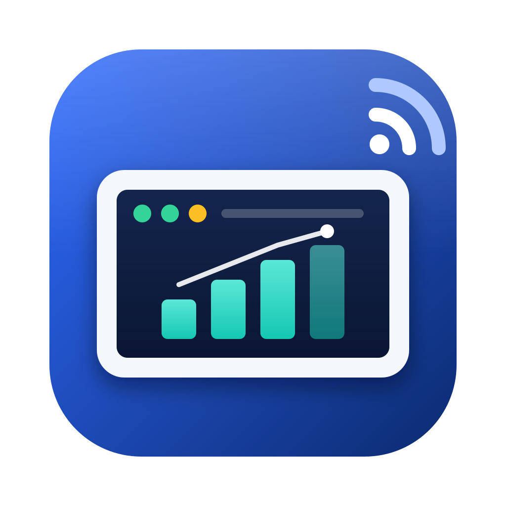

# APPC Tablet Dashboard (Python version 0.4)



A web page for managing APPC-10DSQPL tablets running the Android 7.1 firmware from this project. It runs on a Windows PC, a Mac, a Linux computer or a Raspberry Pi, and you use it from a web browser.

> [!IMPORTANT]
> **The dashboard only works with tablets on the same network as the computer it runs on.** It talks to each tablet directly over the local network (network debugging, port 5555). It is not a cloud service and cannot reach tablets over the internet. To manage tablets at another site, the computer running the dashboard must be on that site's network, for example through a VPN that connects the two networks.

## What it does

- **Status:** online or offline, screen on or off, the app showing, storage, memory, uptime and the tablet's clock.
- **Screen:** a screenshot of what is on the tablet now, optionally refreshed every 5 seconds.
- **Identify:** flashes the side LEDs for 30 seconds to find a tablet (PoE/LED model).
- **Storage:** browse internal storage and the SD card; upload, download and delete files; create folders; install an `.apk`; install a firmware image.
- **Power:** screen on/off and restart, now or on a schedule.
- **Power schedule:** weekly times (optionally from or until a date), times on specific dates, days off, quiet hours and a 14-day preview.
- **Start-up app:** the app that opens at start-up, pinning (kiosk mode), the unpin PIN, and restarting the pinned app if it crashes.
- **Date and time:** the tablet's clock, time zone and network time.
- **Copy settings:** copies the schedule, start-up app, buttons, adb switches, brightness and volume, or time zone to other tablets.
- **Firmware for several tablets at once:** upload an image once, tick the tablets, and each one gets it copied, checked and installed, with progress shown.
- **Buttons:** what each front button does.
- **Apps:** install apps from an APK library onto one or more tablets; open, close or uninstall apps.
- **Network adb:** the tablet's network debugging switches and the computers it has refused.
- **Progress:** uploads and installs show a progress panel.

Shutting tablets down is deliberately not offered, because the tablets cannot switch themselves back on.

## What you need

- **A computer on the same network as the tablets:** Windows 10 or 11, macOS, or Linux (including Raspberry Pi OS).
- **Python 3.7 or newer.** The dashboard uses only Python's standard library; nothing else needs installing with pip.
- **adb** (Android Debug Bridge), from Google's Android SDK Platform-Tools.
- **Tablets running this project's Android 7.1 firmware.** USB set-up needs firmware N1.7 or newer.

## Install

The dashboard is these files, kept together in one folder:

| File | What it is |
|---|---|
| `appc_dashboard.py` | The dashboard |
| `appc_cert.py` | Makes the HTTPS certificate |
| `index.html`, `logo.svg` | The web page |
| `start-dashboard-windows.bat`, `start-dashboard-mac.command`, `start-dashboard-linux.sh` | Start scripts for each system |
| `README.md` | These instructions |

Unzip the folder somewhere permanent, for example `Documents\APPC Tablet Dashboard` on Windows or `~/appc-dashboard` on a Mac or Linux. Your settings, logins and tablet list are saved in this same folder.

### Windows

1. **Install Python** from [python.org/downloads](https://www.python.org/downloads/). In the installer, tick **"Add python.exe to PATH"**.
2. **Get adb:** download **SDK Platform-Tools for Windows** from [developer.android.com/tools/releases/platform-tools](https://developer.android.com/tools/releases/platform-tools). Unzip it **into the dashboard folder**, so that there is a `platform-tools` folder next to `appc_dashboard.py`. The dashboard finds `platform-tools\adb.exe` there by itself. (If adb is already on your PATH, that works too.)
3. **Start it:** double-click `start-dashboard-windows.bat`. A window opens and shows the dashboard's messages; keep it open while you use the dashboard.
4. **Open** http://127.0.0.1:8080/ in your browser.

When you later allow other computers to use the dashboard, Windows asks whether Python may accept connections on the network. Allow it for **Private networks**.

### Mac

1. **Install Python:** in Terminal run the command below and click **Install**. This adds Apple's command line tools, which include Python 3. (Python from python.org works too.)

   ```bash
   xcode-select --install
   ```

2. **Get adb**, either with Homebrew:

   ```bash
   brew install --cask android-platform-tools
   ```

   or download **SDK Platform-Tools for Mac** from [developer.android.com/tools/releases/platform-tools](https://developer.android.com/tools/releases/platform-tools) and unzip it into the dashboard folder (as a `platform-tools` folder next to `appc_dashboard.py`).
3. **Start it:** double-click `start-dashboard-mac.command`. A Terminal window opens; keep it open while you use the dashboard. The first time, macOS may refuse to open it because it was downloaded: go to **System Settings › Privacy & Security**, click **Open Anyway** next to its name, then double-click it again. (Or start it from Terminal: `cd` into the folder and run `python3 appc_dashboard.py`.)
4. **Open** http://127.0.0.1:8080/ in your browser.

### Linux and Raspberry Pi

1. **Install Python and adb.**
   - Debian, Ubuntu and Raspberry Pi OS:

     ```bash
     sudo apt install python3 adb
     ```

   - Fedora:

     ```bash
     sudo dnf install python3 android-tools
     ```

2. **Start it** from the dashboard folder:

   ```bash
   ./start-dashboard-linux.sh
   ```

   If that says "Permission denied", run `python3 appc_dashboard.py` instead (same options).

3. **Open** http://127.0.0.1:8080/ in a browser on the same computer. A Raspberry Pi without a screen needs the dashboard reachable from other computers: start it with `./start-dashboard-linux.sh --host 0.0.0.0` and open `http://<the Pi's address>:8080/` from another computer.

To start it automatically when the Pi starts, see [Start automatically](#start-automatically).

## First start

1. **Choose a login.** The first time the page is opened, it asks you to choose a user name and password. If you open it from another computer, it also asks for the **setup code**, which is shown in the dashboard's window:

   ```
   First start: open the page and choose the login. From another computer the setup code is 123456
   ```

2. **Allow other computers (optional).** At first, only the computer running the dashboard can open the page. To use it from other computers, go to **Settings** and choose "Other computers on the network too" (or one of the computer's addresses). More logins can be added there.
3. **HTTPS (recommended on a shared network).** Switch it on under **Settings**. The dashboard makes its own certificate. Browsers warn about it at first: either accept the warning, or download the certificate from **Settings** and add it to the trusted certificates of the computers that use the dashboard.

**Port.** The dashboard uses port 8080. If another program already uses it, the dashboard runs on the next free port and says so, for example "Port 8080 is in use by another program, so the dashboard is running on port 8081". **Settings** then offers a button to keep using the new port. You can also change the port there.

**Forgotten password.** Set a new one from the dashboard folder with the command below, using your user name instead of `admin` (Windows: `py appc_dashboard.py --set-password admin`):

```bash
python3 appc_dashboard.py --set-password admin
```

## Add your tablets

Each tablet has to allow remote management once. There are two ways.

### Option 1: over USB (firmware N1.7 or newer)

1. Plug the tablet into the computer running the dashboard with a USB cable.
2. On the tablet, **"Allow USB debugging?"** appears: tick **Always allow from this computer** and tap **OK**.
3. On the dashboard page, **Tablets on USB** shows the tablet. Click **Set up for the network**.

This switches on remote management and network debugging, stores this computer's key on the tablet (so it connects over the network without asking again), and adds the tablet to the list by its network address. The cable can then be unplugged.

On Windows, adb may need a USB driver before it can see the tablet. If the tablet does not appear under **Tablets on USB**, use option 2.

### Option 2: on the tablet

1. On the tablet, go to **Settings › Developer options › Network debugging & remote management** and switch on **Allow remote management**.
2. On the dashboard page, add the tablet by its IP address (shown on the same tablet screen, and under Settings › About tablet › Status). `:5555` is added automatically.
3. The first time, the tablet asks **"Allow debugging?"**: tick **Always allow from this computer** and tap **Allow**.

While remote management is off, the dashboard only shows whether that tablet is online and refuses everything else.

## Good to know

- **Same network only.** The dashboard reaches each tablet at its local network address. A tablet on another network, or behind another router, cannot be managed.
- **Only while the page is open.** The dashboard contacts the tablets only while its page is open in a browser tab. Left running with no page open, it does nothing, and it drops its connections within a minute.
- **One computer at a time.** Android 7.1 only talks to one network adb computer at a time, so the dashboard disconnects from a tablet after 30 seconds without work. If a tablet shows **"In use by another computer"**, another computer is connected to it: close that computer's dashboard, or run `adb disconnect <tablet IP>:5555` on it.
- **Approval belongs to the computer's key.** Tablets remember this computer by its adb key (in the `.android` folder of your user's home folder). If you move the dashboard to another computer, approve it on the tablets again (or copy that key).
- **Status meanings:** **Approve on tablet** = tap Allow on the tablet's screen; **Remote management off** = switch it on at the tablet; **Offline** = the tablet cannot be reached on the network.

## Start automatically

**Raspberry Pi or Linux (systemd).** Create `/etc/systemd/system/appc-dashboard.service`, with your user name and folder:

```
[Unit]
Description=APPC tablet dashboard
After=network-online.target

[Service]
User=pi
ExecStart=/usr/bin/python3 /home/pi/appc-dashboard/appc_dashboard.py --host 0.0.0.0
Restart=on-failure

[Install]
WantedBy=multi-user.target
```

Then enable and start it:

```bash
sudo systemctl enable --now appc-dashboard
```

Read the first-start setup code with:

```bash
journalctl -u appc-dashboard | grep "setup code"
```

**Windows.** Press Win+R, type `shell:startup` and press Enter. Put a shortcut to `start-dashboard-windows.bat` in the folder that opens. The dashboard then starts when you sign in to Windows.

**Mac.** Add `start-dashboard-mac.command` under **System Settings › General › Login Items**.

## Command-line options

Add these after `appc_dashboard.py` or after the start script's name.

| Option | What it does |
|---|---|
| `--host ADDRESS` | Address to listen on for this run, for example `0.0.0.0` for every network. Otherwise as set under Settings (this computer only at first). |
| `--port N` | Port for this run. Otherwise as set under Settings (8080 at first). |
| `--https`, `--no-https` | HTTPS on or off for this run. |
| `--data FOLDER` | Where settings, logins, the tablet list and the `apks/`, `firmware/` and `tls/` folders are kept. Default: the dashboard's own folder. |
| `--adb PATH` | Which adb to use. Default: adb on the PATH, then `platform-tools` next to the dashboard, then the Android SDK's usual folder. |
| `--set-password USER` | Set a login's password in the terminal, then exit. |
| `--no-login` | No user name or password. Only for a computer nobody else can reach. |
| `--interval 60` | Seconds between status checks. |
| `--idle 30` | Disconnect from a tablet after this many idle seconds. |

## Updating the dashboard

Replace `appc_dashboard.py`, `appc_cert.py`, `index.html` and `logo.svg` with the new versions. Your settings, logins, tablet list and libraries (`config.json`, `devices.json`, `apks/`, `firmware/`, `tls/`) stay as they are.

## Troubleshooting

- **"adb does not run (adb not found)":** install adb as described above, or point to it with `--adb`.
- **"python3 is not recognised" / "Python was not found" on Windows:** reinstall Python with "Add python.exe to PATH" ticked, or use the Windows start script, which also tries the `py` launcher.
- **The page does not open from another computer:** under **Settings**, allow other computers; on Windows, allow Python through the firewall for private networks; check you are using the right address and port (shown in the dashboard's window).
- **A tablet stays Offline:** check the tablet is on the same network, its IP address is right, and network debugging is on (Settings › Developer options › Network debugging & remote management).
